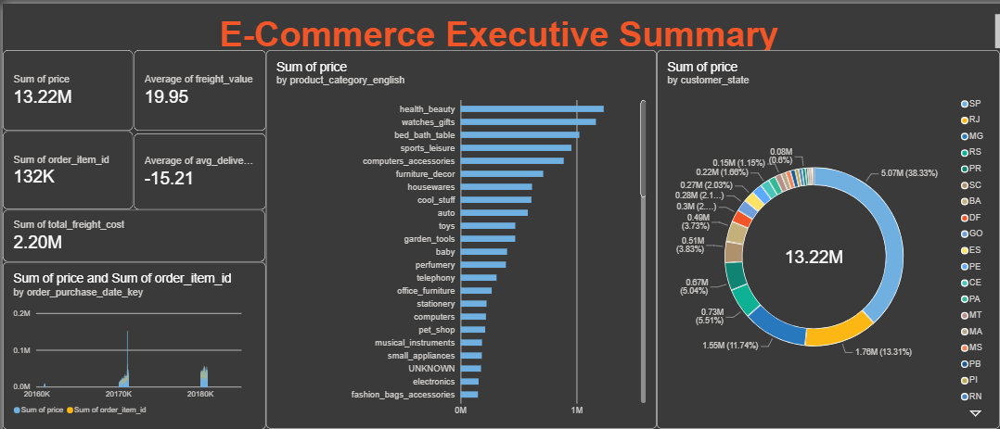
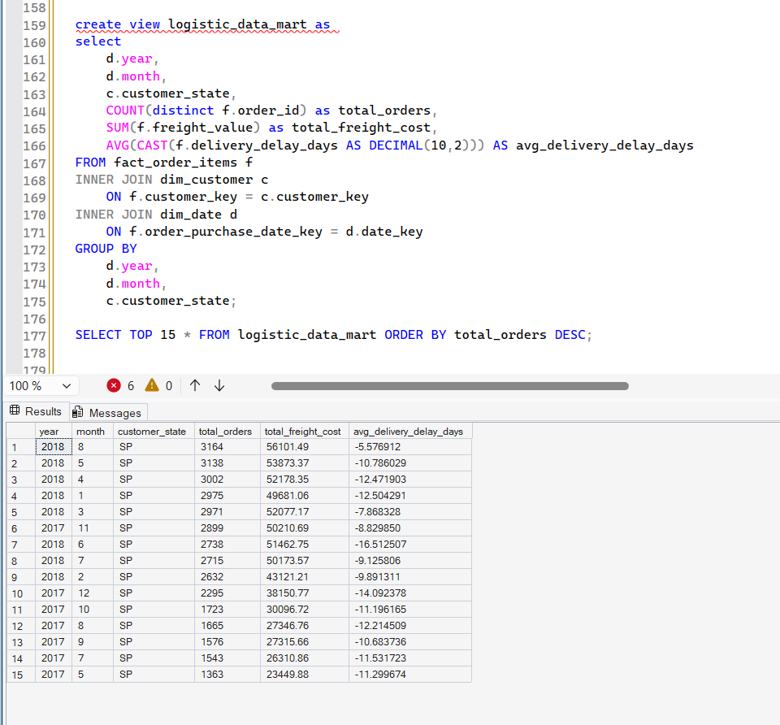
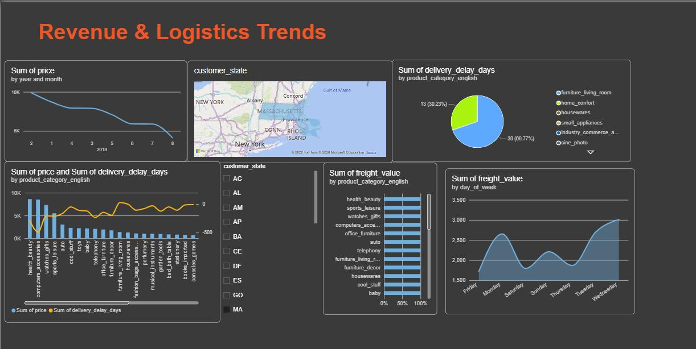
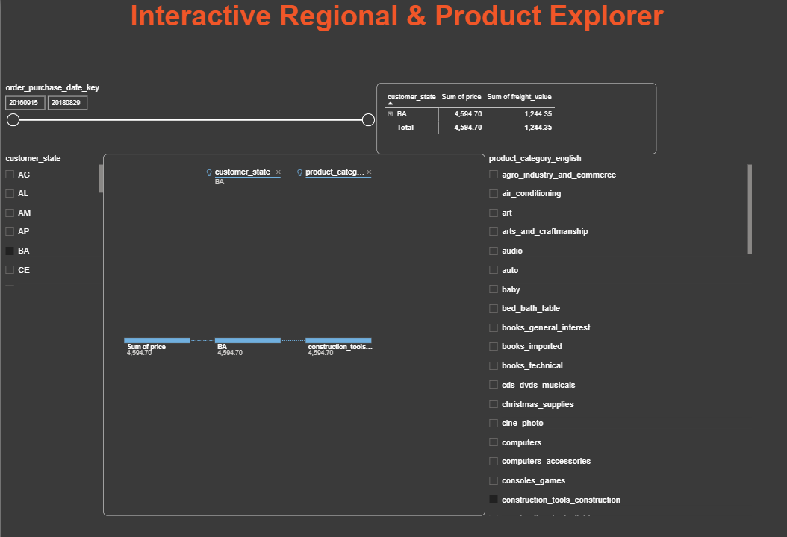

# Olist E-commerce Data Warehouse & BI Dashboard

An end-to-end **Data Warehousing and Business Intelligence** solution built on the
[Brazilian E-Commerce Public Dataset by Olist](https://www.kaggle.com/datasets/olistbr/brazilian-ecommerce).
Raw operational (OLTP) CSV data is staged in **Microsoft SQL Server**, cleaned and transformed with
**T-SQL**, loaded into a **star schema**, summarised in a **Logistics Data Mart**, and analysed in a
3-page **Power BI** dashboard focused on revenue, freight cost and delivery performance.

> IT3101 – Data Warehousing & Business Intelligence · BSc (Hons) IT – Data Science, SLIIT · Group 2026-DS-09



---

## Highlights

| | |
|---|---|
| **Source data** | 9 normalised CSV files · ~99K orders · 112K order items · Sep 2016 – Oct 2018 |
| **Warehouse** | SQL Server · staging area → star schema (1 fact + 4 dimensions) |
| **ETL** | T-SQL: type casting, text standardisation, translation lookup, surrogate keys, derived metrics |
| **Data mart** | `logistic_data_mart` — orders, freight cost and delivery delay by month and state |
| **BI** | Power BI · Executive Summary, Trends, Interactive Explorer |

## Architecture

```
 Data sources            Integration (ETL)              Storage                         Presentation
┌──────────────┐   ┌───────────────────────────┐   ┌──────────────────────────┐   ┌──────────────────┐
│ 9 Olist CSVs │──▶│ Extract → stg_* tables     │──▶│ Star schema (EDW)        │──▶│ Power BI         │
│ (OLTP)       │   │ Transform with T-SQL       │   │ fact_order_items + dims  │   │ 3-page dashboard │
└──────────────┘   │ Load into dims, then fact  │   │ Logistics Data Mart view │   └──────────────────┘
                   └───────────────────────────┘   └──────────────────────────┘
```

1. **Data source layer** – nine CSV files: orders, order items, customers, sellers, products,
   payments, reviews, geolocation and category translations.
2. **Integration layer** – raw files are bulk-imported into `stg_*` staging tables as strings
   (so dirty rows never break the load), then transformed in-database with T-SQL.
3. **Storage layer** – staging area, the enterprise star schema, and a department-specific
   Logistics Data Mart.
4. **Presentation layer** – Power BI connected to SQL Server for slicing, drill-down and roll-up.

## Star schema

**Grain:** one row per product item shipped in a delivered order.

```
                    dim_date
                       │
 dim_customer ── fact_order_items ── dim_product
                       │
                   dim_seller
```

| Table | Key columns / attributes |
|---|---|
| `fact_order_items` | `customer_key`, `seller_key`, `product_key`, `order_purchase_date_key` · measures: `price`, `freight_value`, `delivery_delay_days` |
| `dim_customer` | `customer_key` (surrogate) · state → city → zip hierarchy |
| `dim_seller` | `seller_key` (surrogate) · state → city → zip hierarchy |
| `dim_product` | `product_key` (surrogate) · English category, weight and dimensions |
| `dim_date` | `date_key` (YYYYMMDD) · year → quarter → month → day of week |

**Design decisions**
- **Star over snowflake** – location attributes are denormalised into the customer and seller
  dimensions to cut joins and speed up Power BI.
- **Delivered orders only** – cancelled and unavailable orders are excluded so they don't skew
  logistics metrics.
- **Surrogate keys** – `IDENTITY` integer keys with formal foreign-key constraints keep the
  warehouse independent of the source system's natural keys.

## ETL (T-SQL)

| Step | Technique |
|---|---|
| Type casting | `TRY_CAST` strings to `DECIMAL(10,2)`, `INT` and `DATE` without failing on bad rows |
| Standardisation | `UPPER(TRIM(...))` on city and state fields for consistent grouping |
| Translation | `LEFT JOIN` to map Portuguese product categories to English |
| Missing values | `COALESCE(..., 'UNKNOWN')` for unmapped categories |
| Derived metric | `delivery_delay_days = DATEDIFF(DAY, estimated, delivered)` |
| Loading | Dimensions first (surrogate keys generated), then the fact table via key lookups |

Scripts:
- [`sql/01_star_schema_and_etl.sql`](sql/01_star_schema_and_etl.sql) – creates the dimensions and fact table and loads them from staging
- [`sql/02_logistics_data_mart.sql`](sql/02_logistics_data_mart.sql) – creates the Logistics Data Mart view



## Power BI dashboard

The report is in [`powerbi/olist_dashboard.pbix`](powerbi/olist_dashboard.pbix) (open with Power BI Desktop).

**1 · Executive Summary** – revenue, orders, freight and delivery-delay KPIs, revenue by product
category and by customer state.

**2 · Revenue & Logistics Trends** – monthly revenue trend, freight by day of week, revenue vs
delivery delay by category, and a customer-state map.



**3 · Interactive Regional & Product Explorer** – date-range, state and category slicers, a matrix
for roll-up, and a decomposition tree for drill-down.



## Key insights

| KPI | Value |
|---|---|
| Total revenue | **13.22M** |
| Total freight cost | **2.20M** |
| Average freight per item | **19.95** |
| Average delivery delay | **−15.21 days** (arrives early) |

1. **Market concentration** – São Paulo (SP) alone generates **38.3%** of revenue and, with Rio de
   Janeiro (RJ, 13.3%), over half of all income. Fulfilment centres and marketing spend should
   focus there.
2. **Top categories** – *health & beauty* and *watches & gifts* lead revenue, ahead of electronics
   and computers. These categories should be prioritised in inventory planning.
3. **Over-cautious delivery estimates** – orders arrive about **15 days earlier** than promised.
   Tighter, more accurate estimates at checkout could lift conversion.
4. **Revenue decline in 2018** – the monthly trend falls steadily through 2018, which calls for
   root-cause analysis and re-engagement campaigns.
5. **Freight optimisation** – freight costs vary by day of week and category, so there's room to
   steer customers toward cheaper shipping windows.

## Tech stack

`Microsoft SQL Server` · `SSMS` · `T-SQL` · `Power BI` · `Dimensional modelling` · `ETL`

## Running it yourself

1. Download the dataset from [Kaggle](https://www.kaggle.com/datasets/olistbr/brazilian-ecommerce).
2. Import each CSV into SQL Server as a `stg_*` table (all columns as `NVARCHAR`).
3. Run `sql/01_star_schema_and_etl.sql`, then `sql/02_logistics_data_mart.sql`.
4. Open `powerbi/olist_dashboard.pbix` in Power BI Desktop and point it at your database.

## Author

**Adithya Bandara** – [Portfolio](https://adirc7.github.io) · [LinkedIn](https://www.linkedin.com/in/adithya-bandara-3808192b2) · [GitHub](https://github.com/Adirc7)

Group project (IT3101, SLIIT – Group 2026-DS-09).
